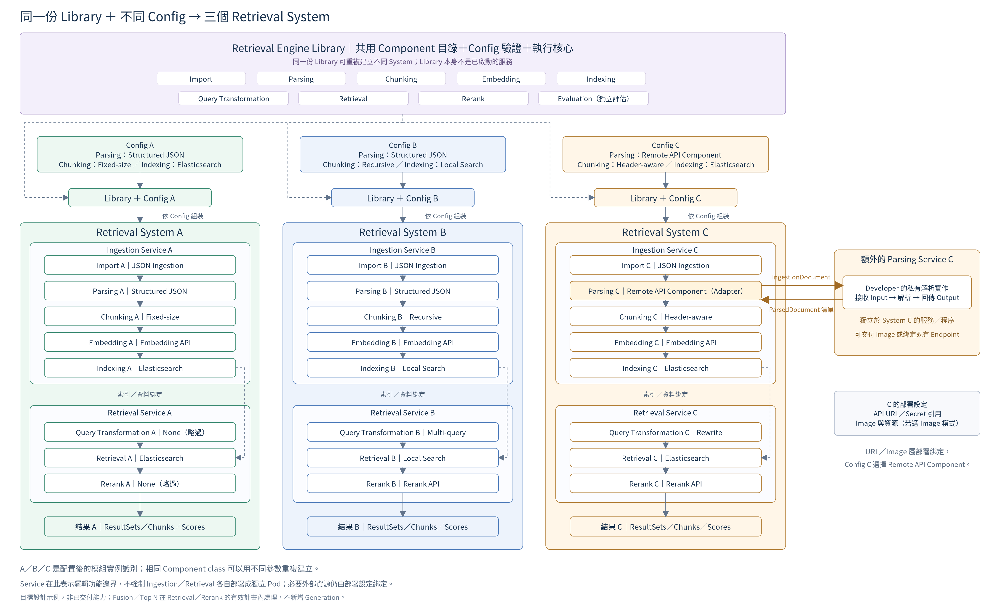

# 完整 Library 目錄與三種 Retrieval System 配置

> 2026-11-02 D-51 補充：圖中 Remote API Component 是單 Module 範例；新確認的 Remote Pipeline 也可承接連續多 Module，透過 Manifest 註冊供 User 選用。組裝、部署與資料責任見 [18](../docs/03_engine_and_components.md)。2026-11-03 D-54：推論接線已同步 QueryContext[]，原有完整 Component 目錄與 A／B／C 版面保留。

2026-11-02｜目標設計示例，非已交付能力。

[Mermaid 關係定義](03_module_component_concept.mmd) · [固定版面 SVG](03_module_component_concept.svg)

## 報告說明重點

1. **上半部保留完整 Library 目錄。**原有內建 Component、可自行開發的擴充點、Module 及 Developer 測試／發布流程都保留；每個既有選項獨立一格。8 個 Module（Import／Parsing／Chunking／Embedding／Indexing／Query Transformation／Retrieval／Rerank）各增 Remote API Component，不增加 Generation。
2. **A：直接使用內建。**Config A 選既有 Component，無須開發者額外交付方法程式。內建 API Adapter 仍可能呼叫模型／DB，並不表示所有處理都沒有外部依賴。
3. **B：有使用到 Developer 在 Library 開發的 Component。**Chunking 目錄新增 XXX_component，Config B 選它，System B 的實例標為「Chunking B｜XXX_component（Local）」。圖中的名稱是示例；正式 component_id／版本依 Registry 規範登錄，不新增名為 XXX_component 的 Module。
4. **C：在某個 Module 有使用 Remote API 來連結 Developer 提供的 Service。**Config C 的 Parsing 選 Remote API Component，System C 內仍是 Retrieval Builder 提供的 Parsing C Adapter，私有解析邏輯在額外的 Parsing Service。傳入 IngestionDocument、回傳 list[ParsedDocument]；Image Deployment／External Endpoint 交付均適用，見 [04](04_component_delivery_modes.md)。
5. **三者共用同一份 Library。**配不同 Config 與必要資源綁定後建立不同 System；不是為 A／B／C 複製三份 Library 或要求三套 Component class。

| 示例 | 核心差異 | Parsing | Chunking | Indexing／Retrieval | Query Transformation | Rerank |
|---|---|---|---|---|---|---|
| A | 內建 Component | Structured JSON | Fixed-size | Elasticsearch | None | None |
| B | 有使用到 Developer 在 Library 開發的 Component | Structured JSON | **XXX_component（Local）** | Local Search | Multi-query | Rerank API |
| C | 在某個 Module 有使用 Remote API 來連結 Developer 提供的 Service | **Remote API Component** | Header-aware | Elasticsearch | Rewrite | Rerank API |

C 的例子假設遠端 Parser 產出相容、保留 Markdown 標題的 Unit.text，才能使用 Header-aware；共同物件形狀不免除格式與語意驗證。Local／Remote Parser 的實際教學程式見 [16](../docs/03_engine_and_components.md)。

## 邊界與連線

- 實線表示組裝或執行順序；虛線表示共用 Library 或索引／資料綁定，並不表示 Query 會重新跑 Ingestion。
- Parsing C 與額外服務的雙向箭頭是 HTTP request／response；不是每一個 Module 都需要變成獨立微服務。
- Ingestion Service／Retrieval Service 是邏輯功能邊界；Runtime 的程序、Pod 與多 System 配置仍由架構／部署政策決定。
- Fusion／Top N 由配置的結果處理計畫執行，這裡不新增 Module 或 Generation。

## Remote API 目錄的解讀

每個 Module 的 Remote API Component 是該 Module 契約下的 Adapter，並非一支不檢查資料的通用 HTTP 呼叫器。Config Schema／能力／版本／錯誤仍需登錄與驗證；有狀態的 Indexing／Retrieval 還需匹配索引、資料版本及讀寫政策。圖中新增目標選項不代表已有完整 HTTP／部署契約或正式實作。

Developer 的 Local Component 沿原有 PR／測試／Runtime Image 交付；Remote Developer 可保留私有實作，交付 API Image 或端點。Runtime 必須已包含相容 Adapter，目錄與服務綁定亦須驗證，不能把外部程式直接塞入 Config 執行。

## Library 內 Module 之間的 Contract 名稱

圖中 `[]` 表示清單；線上標示相鄰 Module 的主要業務資料，引用 [04 §3.1](../docs/03_engine_and_components.md#src-04-31-io-接線)，不另定新物件或 HTTP Envelope。

| 連線 | 標示 | 說明 |
|---|---|---|
| Import → Parsing | IngestionDocument | API／Import／Parser 共用相同輸入 |
| Parsing → Chunking | ParsedDocument[] | 每份文件有平面 Units；Parser 可輸出多文件 |
| Chunking → Embedding | Chunk[] (vectors={}) | Chunker 輸出初始化為空向量 |
| Embedding → Indexing | Chunk[] (Embedding 後) | 向量寫回原 Chunk.vectors，不另傳 VectorSet；略過 Embedding 時仍可為 {} |
| Indexing ⇢ Retrieval | IndexBinding | 索引／資料目標、版本與可用狀態的綁定，不是每次 Query 重跑 Ingestion |
| Query Transformation → Retrieval | QueryContext[] | 原始／改寫問題、filters／metadata 及目前 result_sets，沒有外框 |
| Retrieval → Rerank | QueryContext[] | context 內保存目前各路 key／items 與選填 score |
| Rerank → 檢索結果 | QueryContext[] | 替換目前分數／順序後回傳；None 沿用 |

推論三模組業務輸入輸出直接使用 list[QueryContext]；result_sets 巢狀在 context 內，不另外傳獨立 ResultSet[]。目前結果被替換，歷史與診斷寫 Logs；Chunk._rag 選填追溯不受影響。本地 Parser 教學可用 ModuleResult，但不加在推論 HTTP body 外。A／B／C 與 Remote Parsing 範例版面保留。

D-62／D-66 解讀：圖中的 System／Component 實例是邏輯配置與資料作用範圍，不要求逐 Config 建立專屬 Flow、API service 或 Pod。Builder 的實際模式採共用 Executor／固定 Config 快照，Remote Image 的額外服務仍依 18 部署。配置格式與圖說校對見 [23](../docs/05_system_config.md)／[24](../docs/history/reviews/2026-11-05_spec_alignment_review.md)，不把示意圖當成已完成執行架構。
