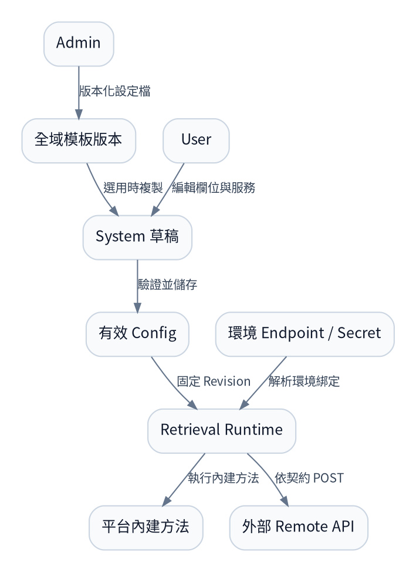

# Retrieval Component 的三種交付模式

> 2026-11-02 D-51 補充：本圖保留原三種交付模式視覺；Remote 也可涵蓋連續多個 Module。Developer 以 Service Manifest 註冊，User 選服務；DEV Image 由平台每 System 啟動獨立實例並自動解析 Endpoint，External 由 Developer 部署維運。完整生命週期、固定資料空間與 Export 差異見 [18](../docs/18_remote_service_pipeline_integration.md)。本次未重畫 PNG／SVG。

2026-11-02 討論方案示意。Remote API 的正式 HTTP Contract、Deployment Descriptor、DEV 部署／Export 整合尚待規格與實作；本圖不是已交付功能清單。

[可編輯 SVG](04_component_delivery_modes.svg)

| 模式 | Developer 交付物 | 執行位置 | Remote API 部署責任 | Export YAML |
|---|---|---|---|---|
| Local Component | Component 原始碼、設定／契約描述 | Retrieval Runtime 內，與 Library 同程序 | 無額外 Remote API；使用單位部署 Runtime | Runtime＋Config，Component 已包入 Runtime Image |
| Remote API — Image Deployment | Service Manifest、API Image、部署描述與契約資訊 | 獨立 API 服務，圖中示意為同一使用單位環境 | 使用單位以匯出 YAML 部署；Developer 交付 Image 版本 | Runtime＋Config，以及 Remote API 的 Deployment／Service／資源／Secret 引用等必要設定 |
| Remote API — External Endpoint | Service Manifest、Endpoint／認證環境綁定與契約資訊 | Developer 管理的 API 服務，不要求交付原始碼或 Image | Developer 自行部署與維運 | Runtime＋Config＋API 連線／Secret 引用，不產生遠端服務部署 YAML |

共同規則：

- 單 Module 的三種模式遵守相同 Module I/O Contract；整段 Remote Pipeline 遵守涵蓋範圍的輸入／輸出邊界 Contract，不要求回傳中間物件。Remote API Adapter 傳送可序列化的業務 Input，驗證回應後還原 Module Output；不傳送整個可信 RunContext。
- Library 依 Config 組裝 System；Remote API 模式仍在 Runtime 內有 Adapter，遠端演算法在另一個服務／程序執行。
- 演算法參數放 Config；部署模式、Image、URL、Secret 與 CPU／Memory 等放 Deployment Settings。Developer 已固定的服務設定隨服務版本宣告，不要求 User 再填；開放呼叫參數才顯示表單。Image 模式需要明確部署描述，不能僅靠 Image 名稱推導所有設定。
- API 指的是 Module 的遠端執行端點。Local Component 仍可依自身用途連線 DB／模型服務；圖中「無額外 Remote API」不代表完全沒有外部依賴。
- Image 模式可在 DEV 部署測試 Image；External 模式綁定測試端點。DEV 與 FTEST／ENT 沿用相同 I/O 契約。
- Indexing／Retrieval 等有狀態操作，仍須額外定義索引識別、版本、讀寫關係及冪等／重試政策，不能僅憑 HTTP 形狀宣稱相容。

## 搭配開發範例介紹

先用本圖說明三種交付模式，再讀 [16 Parser 開發範例](../docs/16_parser_component_development_examples.md)：同一組 IngestionDocument／ParsedDocument，對照 Local ABC 實作與 Remote API／Adapter。開發方式分兩種；Image Deployment／External Endpoint 共用 Remote API 開發契約。

D-62／D-66 解讀：圖中的 System／Component 實例是邏輯配置與資料作用範圍，不要求逐 Config 建立專屬 Flow、API service 或 Pod。Builder 的實際模式採共用 Executor／固定 Config 快照，Remote Image 的額外服務仍依 18 部署。配置格式與圖說校對見 [23](../docs/23_system_config_schema_draft.md)／[24](../docs/history/reviews/2026-11-05_spec_alignment_review.md)，不把示意圖當成已完成執行架構。
