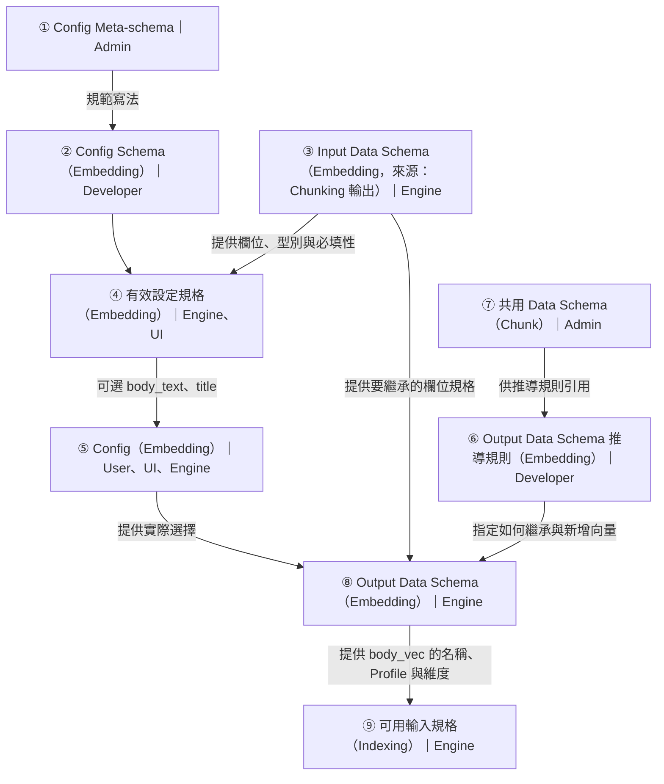

# Component Descriptor：已確認行為、格式草案與決策

## 閱讀目錄

- [所屬範疇與閱讀入口](#src-24-1-所屬範疇與閱讀入口)
- [要區分的三類 Schema](#src-24-2-要區分的三類-schema)
- [共用格式固定，內部欄位可以變](#src-24-3-共用格式固定內部欄位可以變)
- [第一版純 Descriptor 可表達的規則](#src-24-4-第一版純-descriptor-可表達的規則)
- [第一版的邊界與未知欄位](#src-24-5-第一版的邊界與未知欄位)
- [沿 Pipeline 推導設定選項](#src-24-6-沿-pipeline-推導設定選項)
  - [說明範例：Chunking → Embedding 的 Schema 相依](#chunking-embedding-schema-walkthrough)
    - [③ 與 ⑧：完整 Data Schema 對照](#embedding-input-output-schema-comparison)
- [Ingestion API 的驗證與 document_schema 收斂](#src-24-8-ingestion-api-的驗證與-document_schema-收斂)
- [目的與已確認行為](#src-12-1-目的與已確認行為)
- [Config Schema 的第一版支援範圍](#src-12-5-config-schema-的第一版支援範圍)
- [UI hints 與標準控制項](#src-12-6-ui-hints-與標準控制項)
- [動態選項與能力 Context](#src-12-7-動態選項與能力-context)
- [相依規則與有效設定](#src-12-8-相依規則與有效設定)
- [Runtime 回傳、定位與版本](#src-12-10-runtime-回傳定位與版本)
- [開發與驗收案例](#src-12-11-開發與驗收案例)
- [Descriptor 共同骨架](#src-25-2-descriptor-共同骨架)
- [scope、Contract 引用與接線](#src-25-3-scopecontract-引用與接線)
- [$ref 與邏輯相依分開](#src-25-4-ref-與邏輯相依分開)
- [data_rules：兩個操作表達六類能力](#src-25-5-data_rules兩個操作表達六類能力)
- [Embedding A→B 完整比對](#src-25-6-embedding-ab-完整比對)
- [Parser 與其他案例](#src-25-7-parser-與其他案例)
- [驗證層次與本輪實際證據](#src-25-8-驗證層次與本輪實際證據)
- [需要決策的項目與建議](#src-25-9-需要決策的項目與建議)
- [標準依據與遷移](#src-25-10-標準依據與遷移)
- [語法整合的適用界線](#語法整合的適用界線)


更新：2026-11-05。本手冊是 B 的唯一描述規格入口，整合原本分散的設定 Schema、I/O 細化、動態選項與初版語法。**D-67 的方向／操作行為已確認；component-descriptor/0.1-draft 的具體格式與 DS-01～DS-13 仍待核定。**

閱讀順序：先看責任／六類能力，再看共同骨架、Embedding A→B、五組範例及 DS 決策。舊 component-ui-0.1-draft 語法只留歷史快照，不與本稿並列為現行格式。

<a id="src-24-1-所屬範疇與閱讀入口"></a>
## 所屬範疇與閱讀入口

本議題主要屬 [A～E 責任中的 B：Component 定義](01_architecture.md#src-20-3-最終詳細總表)。本手冊統一維護 Config Schema、UI hints、option_sources、rules、失效選擇卡控，以及Component 如何依 Config 提供 I/O 資料規格，並沿 Pipeline 成為下游設定的依據。

| 群組 | 本議題的責任 |
|---|---|
| A 共用執行契約 | 固定 IngestionDocument、ParsedDocument、Chunk、QueryContext[] 等形狀與語意；Component 不得任意覆寫 |
| **B Component 定義** | 宣告 Config Schema、I/O Contract 引用、資料細節及依 Config 改變的規則、動態選項來源與相依條件 |
| C Remote Manifest | Remote Developer 提供同等宣告，由平台推導／適配成 B；不要求交 Source Code 或手寫兩份描述 |
| D System Config | 保存 Component ID／版本與 User 的參數值；不再要求獨立頂層 document_schema 重複描述 Parser 輸出 |
| E 環境與資源 | 提供服務／Profile 的相容綁定；URL、Secret、Client 與即時資源不混進資料 Schema |

Admin 制定 Descriptor Schema、Schema 支援範圍與規則語意；Developer 依格式交付宣告及實作；User 選 Component 並填 Config。Descriptor 是純 JSON 描述，不是可執行程式。B 的行為同時適用 Local、Remote Image、Remote External；能否動態改欄位與是否交付 Source Code 無關。

<a id="src-24-2-要區分的三類-schema"></a>
## 要區分的三類 Schema

| 類型 | 回答的問題 | 使用者／消費端 |
|---|---|---|
| Descriptor Schema／描述內 Schema 的採用規範 | Developer 應如何描述設定、I/O 與變動規則？ | Admin 定義；Registry 驗證交付內容 |
| Component Config Schema | User 可以設定哪些參數、型別、預設及限制？ | Builder 產生表單；Engine 驗參數 |
| Component I/O Data Schema | 採用目前 Config 後，接受與產出的資料有哪些欄位、型別與限制？ | API／執行資料驗證；下游選項與組裝相容性 |

Config Schema 本身不會自動推出 I/O Data Schema；Developer 必須提供固定資料規格或受支援的變動規則。正式描述的包裝／欄位名稱待定，本文件的文字名稱不是新發布的 JSON 關鍵字。

System Config Schema 的 $defs 只重用共同設定骨架，例如 ComponentSelection、ParserSlot、ChunkTask；新增 Component 不修改這份平台 Schema。Component 自己的 Config／Data Schema 可有自己的 $defs，依 ID／版本分開解析，不把所有 Component 的 Schema 全塞進主 $defs。

<a id="src-24-3-共用格式固定內部欄位可以變"></a>
## 共用格式固定，內部欄位可以變

| 層次 | 規則 |
|---|---|
| 共用物件與既有語意 | ParsedDocument 四鍵＋平面 units、Chunk 六鍵、QueryContext[] 等沿用 A，不因細化改名／省略必要根鍵 |
| 開放的內容容器 | Unit、Chunk.fields、vectors、metadata 遵守各自共用型別；容器允許動態名稱不等於 UI 已知有哪些欄位 |
| Component 的細節 | 可依 Config 指定欄位名稱、型別、必填、來源與適用條件，但不得放寬 A 的限制 |

例如同一 Embedding Component 可由 Config 產出 vectors.text 或 vectors.summary；向量物件仍須遵守共用格式，Profile／維度等限制須有宣告依據。固定 Schema 也可以允許任意合法 Key；它只是不會自動提供精確候選清單。

本設計稱「Pipeline 的 Schema 推導／細化與相依驗證」：各 Module 各自細化自己的 I/O，並非共用一份不斷累加欄位的 Schema。也不要求每次請求產生新的 Python class 或執行 Parser 才取得描述。

<a id="src-24-4-第一版純-descriptor-可表達的規則"></a>
## 第一版純 Descriptor 可表達的規則

「純 Descriptor」指 Developer 以資料宣告規格，不必為每個 Component 另寫 resolve_io_schema 程式；Engine 仍須實作共用解析器。解析只讀已驗證的有效 Config、已宣告的上游 Schema／能力及核可的 Profile 描述；不讀實際文件、Secret、Live Client 或即時遠端狀態。

| 規則 | 設定／宣告例子 | 可推導結果 |
|---|---|---|
| 固定欄位與型別 | Parser 固定提供文字與頁碼 | Unit 的 text:string、page:integer |
| 依參數決定名稱 | output_field 設 body | 輸出 body:string |
| 依映射清單展開欄位 | Embedding 設兩筆映射，輸出名稱 text／summary | vectors.text／vectors.summary；每項沿用已宣告的向量規格 |
| 選擇／複製上游欄位 | 選 title、category，可依支援設定改名 | 沿用來源型別與已知限制；明確 copy 的欄位須可取得 |
| 依布林／固定選項分支 | include_page=true | 加入 page:integer，依宣告決定必填；已知分支可有不同型別／限制 |
| 固定型別的衍生欄位 | 啟用文字模板，輸出名稱 embedding_text | fields.embedding_text:string；真正組合內容仍由 Component 執行 |

上述規則可以組合；第一版不加入任意算式、腳本、自由迴圈或程式下載。來源不存在／型別不明、輸出名稱衝突、不同宣告互相矛盾時報錯，不猜測、不覆蓋欄位。條件與 Config 尚未確定時標示 unresolved，不把未知當成可用。

映射清單展開是平台核定的有限操作，不等同開放任意程式迴圈。條件語法、支援的型別／限制及與 12 rules 的整合仍待 Meta-schema 核定；不把這張行為表當成已完成解析器。

<a id="src-24-5-第一版的邊界與未知欄位"></a>
## 第一版的邊界與未知欄位

| 情境 | 第一版純宣告的限制／處理 |
|---|---|
| 讀 Excel／CSV 才知道實際欄名 | 無法在設定階段列出精確欄位；需提供欄位定義，或由 Sample 推測後確認成設定 |
| JSON 直接傳遞任意業務欄位 | 可以宣告開放物件；若需要下游 Picker／精確驗證，由該 Parser 的 Config 接受欄位定義，不新增全域 document_schema |
| LLM 自行發明 Key 或任意輸出型別 | 不保證靜態候選；若改成固定結構與受支援的限制，可宣告該結構並驗證 |
| 任意 Python／複雜演算法計算 Schema | 超出第一版宣告子集；額外的規格解析介面日後另定，不偷偷執行描述中的程式 |
| Remote 依資料庫即時結構改變回傳 | 沒有交付／確認的 Schema 不能當已知；如何取得額外規格另議，不擅自增加 Remote schema endpoint |

上述「不能」指第一版不保證只靠描述取得精確資料規格，不表示所有開放資料都不能通過共用 Schema。未知 Key 可被寬鬆 Schema 接受，但不得因此當成已知 UI 選項。Sample 是建議／確認來源，不以第一筆樣本推定所有 Units 或所有文件都符合。

文件頁數、Units／Chunks 筆數、文字內容改變通常只是資料不同，不是 Schema 改變。Parser 不需要先知道將產生幾頁才能宣告每個 Unit 的欄位型別。

<a id="src-24-6-沿-pipeline-推導設定選項"></a>
## 沿 Pipeline 推導設定選項

| 元件／設定 | 參考來源 | 規則 |
|---|---|---|
| Chunker 的切分欄位 | Parser 當前輸出的 Unit Schema | 只允許必定可取得且型別／內容能力相容的文字欄位 |
| Chunker 的複製欄位 | 同一 Unit 的欄位 | 只選 Component 支援的型別；沿用來源規格，不自動跨 Unit 找值 |
| Embedding 的來源欄位 | Chunker 當前輸出的 Chunk.fields | 來源必須已產生且符合模型輸入；模板衍生欄位由支援此能力的 Component 宣告 |
| Indexing 的全文／向量／Filter 欄位 | 當前 fields／vectors／metadata 及後端能力 | 只提供已宣告且相容的候選；保存完整 Chunk 不變 |
| Retrieval 的搜尋欄位 | Indexing 的有效配置與支援能力 | 設定階段先檢查計畫；執行時仍須遵守 IndexBinding／索引格式與就緒狀態 |

例如 Parser 宣告 text:string、title:string、page:integer、tags:array[string]。只支援字串切分的 Chunker 可選 text／title；page／tags 仍顯示但停用並說明原因。若該 Chunker 支援複製這些型別，複製欄位可提供四者。Token 上限則依 Chunker 自己的 Config Schema，不因上游多一欄就新增設定功能。

跨 Module 的連動主要改變參數可選值與適用條件；Component Config Schema 仍由同版本 Developer 宣告。上游不會替下游新增未宣告的參數，也不藉改寫 enum 製造每個 System 一份獨立 Component 定義。

Engine 由前往後驗證 Config、解析當前 I/O 資料規格、檢查接線及產生候選。上游設定變動時重新計算受影響的下游；失效選擇保留並報錯，不換第一個選項。錯誤定位及過期回應沿用 12，不因收合／唯讀而略過檢查。UI、AI、Python、API 共用同一 Engine 規則。

多 Parser 必須保留各 profile／分支的輸出宣告；共用 Chunk 任務所需的切分／copy 欄位須在所有會收到的 Units／分支可取得，不能只取候選聯集就宣稱合法。進階多 Chunk 任務各自推導，輸出相加；多結果形狀須標示差異／可用性，不把某任務的欄位誤當每個 Chunk 都有。

Remote 連續區段只在公開邊界交接規格，平台不要求它回報所有內部 Module 的中間物件。區段在 Chunk 邊界提供資料時，下一個 Module 參考該邊界的 Chunk Schema，不捏造不存在的 ParsedDocument。

<a id="chunking-embedding-schema-walkthrough"></a>
### 說明範例：Chunking → Embedding 的 Schema 相依

**前一步的設定會決定它產出哪些欄位，這些欄位又會決定下一步能怎麼設定。** 本例以 Embedding 為主：Chunking 將文字切片命名為 `body_text`，並複製 `title` 和 `page`。接著看 Engine 如何判定哪些欄位可做 Embedding，以及使用者選完之後如何推導輸出規格。以下是設定與契約的說明範例，不新增正式協定。



| 節點 | 在這個例子中的責任與內容 |
|---|---|
| ① Config Meta-schema | Admin 規定 Developer 如何寫 Config Schema，例如用 `properties`、`required` 和 `items` 描述物件與陣列。 |
| ② Config Schema（Embedding） | Developer 定義 `mappings` 是陣列，每列的 `source_field`、`output_name` 都是必填字串；此時還沒有特定 Pipeline 的欄位清單。 |
| ③ Input Data Schema（Embedding） | Engine 取得 Chunking 當前的輸出規格：`fields.body_text` 和 `fields.title` 是字串，`fields.page` 是整數，三者皆必填。Embedding 若另有必填輸入，Engine 也會檢查上游是否提供。 |
| ④ 有效設定規格（Embedding） | Developer 以 `option_sources` 宣告：`/mappings/*/source_field` 從輸入的 `/fields` 取保證存在的字串欄位。Engine 因此解析出 `body_text`、`title` 兩個可選值，UI 顯示 `page` 已停用及原因。Developer 原始的 ② 維持不變。 |
| ⑤ Config（Embedding） | User 在 UI 選 `body_text` 並把輸出命名為 `body_vec`。Engine 使用 ④ 驗證；直接送 API 或 Python 設定也適用同一規則。 |
| ⑥ Output Data Schema 推導規則（Embedding） | Developer 宣告繼承輸入欄位，並逐筆讀取 `mappings`：用 `output_name` 決定 `/vectors` 下的名稱，用 `source_field` 和所選 Profile 約束向量物件。 |
| ⑦ 共用 Data Schema（Chunk） | Admin 定義所有 Chunk 都要遵守的結構，以及 DenseVector 的 `values`、`source_field`、`embedding_profile_id` 等欄位。向量名稱和具體維度留給設定及 Profile 決定。 |
| ⑧ Output Data Schema（Embedding） | Engine 保留 ③ 的三個原欄位，依 ⑥ 把 ⑤ 的設定值帶入，並套用 ⑦ 的契約。結果多了 `vectors.body_vec`，來源限定為 `body_text`，維度由可信 Profile 提供。 |
| ⑨ 可用輸入規格（Indexing） | Indexing 使用 ⑧ 檢查自己的輸入需求，並把 `body_vec` 列為符合條件的向量索引候選；此時不必先執行 Ingestion。 |

**⑤ 的實際設定：** 使用者選的是欄位與 Profile，不需要手寫輸出 Schema。

```json
{
  "profile_id": "example.embedding/v1",
  "service_ref": "embedding.main",
  "mappings": [{"source_field": "body_text", "output_name": "body_vec"}]
}
```

**⑥ 如何使用 ③、⑤ 和 ⑦：** `io.output.inherit` 宣告要保留 `/fields`、`/metadata` 和既有 `/vectors` 的規格；③ 才是 `title`、`page` 等欄位的實際規格來源。這些欄位仍會保留，即使 ⑤ 只選 `body_text` 算向量。繼承宣告讓 Engine 知道輸出應保留什麼；執行時仍由 Embedding 實作傳遞原資料。⑥ 透過 `io.output.contract_ref` 引用 ⑦ 的 Chunk 契約，個別向量的宣告也可用 `$ref` 引用其中的 DenseVector。⑦ 因此可以獨立共用，不需要複製到每份規則裡。

⑥ 稱為「**推導規則**」，因為它說明如何把 ⑤ 代入輸出規格。**Descriptor Meta-schema** 才規範 Developer 可以怎麼寫這些規則；**Draft** 只標示規格尚未定案。具體 `data_rules` 語法見 [Embedding A→B 完整比對](#src-25-6-embedding-ab-完整比對)。

<a id="embedding-input-output-schema-comparison"></a>
#### ③ 與 ⑧：完整 Data Schema 對照

兩份 Schema 都從 `Chunk[]` 開始，並列出每筆 Chunk 的六個外層欄位。`$ref` 都指向同一份[共用 Chunk Schema](../schemas/chunk.schema.json)，因此兩份範例都沿用共用契約的限制。`allOf` 另一項補充本例保證的內容；**兩份 Schema 唯一變動的是 `items.allOf[1].properties.vectors`。**

| 路徑 | ③ Embedding 輸入 | ⑧ Embedding 輸出 |
|---|---|---|
| `fields` | 必須有 `body_text`、`title`、`page` | 保留同樣的欄位與型別，包含沒用來算向量的 `page` |
| `metadata` | 必須有這個物件，可含共用契約允許的資訊 | 沿用同樣的規格 |
| `vectors` | 必須是空物件：本例直接接在 Chunking 之後 | 必須包含 `body_vec`；來源是 `body_text`、維度為 3 |

**③ Input Data Schema（Embedding，來源：Chunking 輸出）**

```json
{
  "$schema": "https://json-schema.org/draft/2020-12/schema",
  "type": "array",
  "items": {
    "allOf": [
      {"$ref": "urn:rag-builder:chunk:0.2-draft"},
      {
        "type": "object",
        "properties": {
          "chunk_id": {"type": "string", "minLength": 1},
          "document_id": {"type": "string", "minLength": 1},
          "source_revision": {"type": "string", "minLength": 1},
          "fields": {
            "type": "object",
            "properties": {
              "body_text": {"type": "string"},
              "title": {"type": "string"},
              "page": {"type": "integer"}
            },
            "required": ["body_text", "title", "page"]
          },
          "metadata": {"type": "object"},
          "vectors": {"type": "object", "maxProperties": 0}
        },
        "required": ["chunk_id", "document_id", "source_revision", "fields", "metadata", "vectors"]
      }
    ]
  }
}
```

**⑧ Output Data Schema（Embedding）**

`body_vec` 和 `body_text` 來自 ⑤ 的映射；3 維來自測試 Profile。`required` 宣告本次必須產生的向量；共用契約仍支援其他流程中的既有向量。

```json
{
  "$schema": "https://json-schema.org/draft/2020-12/schema",
  "type": "array",
  "items": {
    "allOf": [
      {"$ref": "urn:rag-builder:chunk:0.2-draft"},
      {
        "type": "object",
        "properties": {
          "chunk_id": {"type": "string", "minLength": 1},
          "document_id": {"type": "string", "minLength": 1},
          "source_revision": {"type": "string", "minLength": 1},
          "fields": {
            "type": "object",
            "properties": {
              "body_text": {"type": "string"},
              "title": {"type": "string"},
              "page": {"type": "integer"}
            },
            "required": ["body_text", "title", "page"]
          },
          "metadata": {"type": "object"},
          "vectors": {
            "type": "object",
            "properties": {
              "body_vec": {
                "$ref": "urn:rag-builder:chunk:0.2-draft#/$defs/DenseVector",
                "type": "object",
                "properties": {
                  "source_field": {"type": "string", "const": "body_text"},
                  "embedding_profile_id": {"type": "string", "const": "example.embedding/v1"},
                  "values": {"type": "array", "items": {"type": "number"}, "minItems": 3, "maxItems": 3}
                },
                "required": ["source_field", "embedding_profile_id", "values"]
              }
            },
            "required": ["body_vec"]
          }
        },
        "required": ["chunk_id", "document_id", "source_revision", "fields", "metadata", "vectors"]
      }
    ]
  }
}
```

**報告時只改一個值：** 把 Chunking 的輸出名稱從 `body_text` 改成 `content`。② 沒變，④ 的候選卻變了；Engine 應保留 ⑤ 原本的選擇，在 `/mappings/0/source_field` 標出失效原因並阻止套用。修正來源為 `content` 後，⑧ 的來源限制會更新；只要向量仍命名為 `body_vec`，⑨ 的索引欄位選擇就不必改名。這正是複雜度所在：Engine 要重新推導受影響的規格，判斷哪些引用失效、哪些仍成立，讓 UI 和 API 在執行前得到同樣的判斷。

<a id="src-24-8-ingestion-api-的驗證與-document_schema-收斂"></a>
## Ingestion API 的驗證與 document_schema 收斂

共用 API 仍接收非空 IngestionDocument[]；每筆與 Parser Input 相同，content／base64／uri 三選一，不新增另一份 ParserInput 或資料轉換層。

| 時點 | 驗證 |
|---|---|
| 設定／套用前 | 驗證 Component Config、推導 I/O Schema／選項、檢查 Module 與欄位相容；不必先跑文件或初始化模型／DB |
| 回 202 前的整批預檢 | 共用外層、可判定的 Parser 路由／輸入欄位及其他既有快速接收條件；任一不通過則整批拒絕 |
| 背景文件工作 | 需下載、解碼、辨識或實際解析才能驗證的內容；Parser 輸出再驗共用 ParsedDocument＋當前輸出細節，後續 Module 同理 |

202 不表示文件已解析成功。組裝時的 Schema 相容也不保證實際資料／遠端服務遵守宣告；執行期仍驗證並記錄既有工作失敗，不靠 Schema 推導跳過驗證。

取消 D 頂層獨立 document_schema 的要求。固定輸出 Parser 直接提供規格；欄位映射由參數決定規格；任意 JSON Parser 有需要時開放資料欄位定義參數。metadata 的業務限制／Component 處理提示也由適用的 I/O 宣告與參數表達，不重複維護全域權威。可信 metadata／授權保留區仍由 A／Q-006 管理，不能由 Parser 放寬。

Engine／Builder 可保留解析出的規格供驗證與顯示，但它是由 B／C＋D 推導的結果，不是另一份要求 User 手填的來源。快照包裝／版本、Export 是否攜帶解析結果仍待核定。

<a id="src-12-1-目的與已確認行為"></a>
## 目的與已確認行為

Module Developer 宣告 Component 的參數、顯示需求及相依能力；Engine 彙整核可方法，Builder 依描述產生 Component 選單與設定表單。沿用固定的 Retrieval Builder Create／Edit 流程，不增加通用 DAG 畫布。

已確認的操作行為：

1. 相依不滿足的選項仍顯示，但停用並說明原因。
2. 與當前分支無關的欄位不顯示，例如 Memory 不展開 MongoDB 連線設定。
3. 進階設定預設收合；錯誤仍出現在摘要並可定位展開。
4. 上游變更使已選欄位／服務／方法失效時，保留選擇並報錯，不靜默替換；建立／套用執行設定前必須修正。
5. Builder 尚未支援的必要控制項或描述格式明示不支援，不能假裝完整設定完成。

使用者可以繼續編輯無效草稿；這不等於允許儲存為可執行的 ConfigRevision。是否將編輯草稿持久化到 DB 仍依 Q-016／Q-025，既有正式儲存／套用驗證不能繞過。

<a id="src-12-5-config-schema-的第一版支援範圍"></a>
## Config Schema 的第一版支援範圍

規劃使用 JSON Schema Draft 2020-12，前後端 Validator 必須測試同一子集，不以各套件的預設 dialect 猜測。Pydantic 與前端表單套件的版本、轉換層及限制於 M0／M1 鎖定。

| 類別 | 首版規劃 |
|---|---|
| 基本型別 | string、integer、number、boolean、object、array；是否允許 null 必須明示 |
| 物件 | properties、required、additionalProperties；方法設定預設拒絕未知欄位 |
| 固定選項／數值 | enum、const、minimum／maximum、exclusiveMinimum／exclusiveMaximum |
| 字串／陣列 | minLength／maxLength、items、minItems／maxItems、uniqueItems |
| 說明與初值 | title、description、default；格式說明不冒充已執行檢查 |
| 組合與參照 | 本地 `$defs`／`$ref`、allOf、if／then／else；nullable 的明確型別聯集 |
| 暫不提供任意自動表單 | 外部 URL `$ref`、遞迴型別、模糊的 oneOf／anyOf 分支、任意自訂關鍵字；需要時先擴充支援與測試 |

Pydantic 輸出的等價形式若不在核定子集內，須由受測轉換器處理或在註冊時拒絕，不能刪除限制讓它看似相容。`format` 不作為唯一正確性依據；URL、服務引用與相關語意仍由 Engine 檢查。

預設值由 Engine 的共用 Config 正規化流程處理，僅補上缺失且適用的欄位，再驗證；不把 null／空字串／非法值當缺失，也不由 UI 自行改寫使用者的選擇。例：只將 max_tokens 改為 30，預設 overlap_tokens=50 會產生關聯錯誤，不自動縮成 29。已儲存的有效設定保存解析後值與方法版本，不隨新版本 default 漂移。

<a id="src-12-6-ui-hints-與標準控制項"></a>
## UI hints 與標準控制項

UI hints 使用平台自己的 JSON 描述，再由 Builder 映射至選定表單套件；不讓 Component 綁定 React 元件實作或前端程式碼。

| 欄位／控制項 | 用法 |
|---|---|
| `order` | 以方法參數的 JSON Pointer 陣列指定順序；未列欄位仍依 Schema 顯示，不能被遺漏 |
| `groups` | id、title、fields、advanced；advanced=true 預設收合，僅改顯示 |
| `fields` | 以參數 JSON Pointer 為 key，描述 widget、help、placeholder；標題預設取 Schema |
| text／textarea／number／checkbox | 一般字串、Prompt、多行文字、數值及布林 |
| select／multi_select | 固定 enum 或已解析的候選集合；單選／多選需符合 Schema 型別 |
| object／array | 巢狀表單／可重複項目，首版使用固定 items 形狀；錯誤回實際索引路徑 |
| field_picker／service_picker | 連結 `option_source`，候選值與合法性由 Engine 解析 |

動態來源的存在與合法選用不只寫在 UI hints；`option_sources` 本身綁定目標參數，沒有 UI 也必須驗證。Prompt 的插入變數／範例／預覽屬 Builder 共用功能，若 Component 必須依賴該功能，另列 `required_ui_features`，不是只設 textarea 就宣稱完整支援。

只有裝飾性未知 hint 可忽略並提示；未知必要 widget、規則語意或 required_ui_features 時，保留可見的方法與已存設定，禁止在該 Builder 建立／套用不完整設定。沒有自動退回任意 JSON 編輯器的入口。這是 Builder 能力限制，不表示已部署且 Engine 合法的 System 必須停止服務。

<a id="dynamic-options"></a>

<a id="src-12-7-動態選項與能力-context"></a>
## 動態選項與能力 Context

候選 option_sources 使用 id、target、kind、source 與 filter；來源可為已宣告的 input／output 規格或可信 context。具體 kind／路徑與可重複 A→B 的表示統一見下方 Embedding 候選，不再維護 unit_fields 等舊包裝。

選項 Resolver 由 Engine 提供，依輸入 Schema、前序 Module 的有效設定／產出能力、可見的服務引用與目標 Runtime 產生候選。Embedding 不能選尚未產生的欄位；Retrieval 的可搜尋欄位必須對應 Indexing 的有效索引配置。Python／API 傳同一引用也需做相同檢查。

| 候選項目欄位 | 語意 |
|---|---|
| `value`、`label` | 穩定的參數值及顯示文字；改顯示名稱不變引用 |
| `status` | selectable／disabled／unresolved；尚未取得能力不得冒充可用 |
| `reason_code`、`reason` | 停用或未確認原因，UI 以純文字顯示 |

型別／索引能力不符的相關候選保留並停用，權限不可見的項目不因此洩漏。已選引用不在候選內時，另外保留失效選項並報錯，不自動選清單第一項。查詢失敗時保留草稿且標示未驗證，不能以空清單斷言使用者已刪除服務。

`capabilities.requires`／`provides` 使用 `{name, version}` 項目，version 首版比對核定的能力契約版本；能力名稱由平台登錄。requires 由 Engine 檢查實際上游／資源是否提供，不只比較方法名稱。provides 需依有效 Config 推導已啟用能力：ES Adapter 有全文能力不等於這個 System 已替某欄建立全文索引。

規則可讀的 `context` 是 Engine 產生的唯讀、版本化事實，例如 upstream、available_services、effective_index、derived；精確各 Module 事實型別在 M0／M2 按案例擴充。UI 不能自己宣稱具有向量索引／DEV 服務或寫入可信事實。服務清單只含邏輯引用與可呈現資訊，不含 Secret 值。

新增 Config 的相容性可依計畫中的索引能力驗證；實際 Ingestion 是否完成、索引版本是否匹配、外部服務是否連通另列執行就緒檢查。不能因尚無資料就禁止建立 Retrieval System，也不能因 Config 合法就宣稱已有可查詢資料。

<a id="dependency-rules"></a>

<a id="src-12-8-相依規則與有效設定"></a>
## 相依規則與有效設定

規則是受限宣告式資料，不允許 eval、任意程式碼、任意 URL 或指定 Python import path。第一版先支援兩種規則：

| `kind` | 格式與結果 |
|---|---|
| `constraint` | `assert` 為應成立條件；不成立產生 error，選項／方法可停用；目前已選的無效值不得因停用而消失 |
| `applicability` | `when` 為參數是否適用的條件；不適用時依 `presentation` 的 hide／disable 顯示，保留草稿、排除該分支有效值 |

候選規則提供唯一 `id`、參數路徑模式 `target`、`code`、`message`；一般約束／適用性與 unique_by 依下方整合草案定義。首版不提供自動修改欄位的 action；組合只計算狀態，不以規則彼此寫值，避免隱藏的循環改寫。同一 target 的多個 applicability 條件需全部成立；presentation 必須一致，衝突在註冊時拒絕。所有 constraint 都需成立；UI 可彙整多個原因。

具體條件式與路徑模式使用本手冊後面的 data_rules／rules 候選；舊 target.kind 與 set_value 說法不另列第二套語法。

applicability 首版只作用於參數／參數子樹，不能藉此刪除整個必須執行的 Module。使用者選擇 None 等正式略過方法時仍依 Module 的核定流程處理。

未列出的特殊語意檢查以核可 Engine 程式實作並回相同問題格式；若會影響動態選單，Engine 另回可選狀態，Builder 不複製 Python 邏輯。跨模組能力回路由 Engine 的既定 Pipeline／組裝檢查拒絕，不讓顯示規則新增迴圈流程。

**草稿、適用性與合法性分開處理：**

1. 依固定版本描述讀取草稿及 Context，補上適用且缺失的預設值。
2. Engine 判定分支適用性，產生有效參數候選；UI hints 的收合／隱藏本身沒有刪除參數的權力。
3. 驗證有效候選的 Schema、動態引用、constraint、能力與既有完整 Config／索引相容規則。
4. 回傳預覽、可定位問題及必要的重測／重處理影響；有阻擋問題時不產出可套用的有效 Config。

先解析分支選擇與其有效預設，再處理相依參數；適用性與預設值有循環相依的宣告在註冊／編譯時拒絕。條件尚未確定時不以隨意補預設值打破循環，保留待確認問題。複合規則的依賴順序及前後端一致性必須納入 M0 fixtures。

Schema 的條件必填必須與 applicability 分支一致；禁止一面無條件 required，一面宣告該欄不適用。註冊／契約測試需涵蓋各分支。直接 API 傳入已知但不適用的參數時沿用同一排除規則並回明確提示；未知參數仍拒絕。排除項不參與執行、有效 Config Hash 或重建判定；UI 草稿保留，切回時重新驗證。

例如選 Memory 時 MongoDB 綁定不適用，可以保留於部署草稿但不進有效部署設定；刪掉向量索引後仍選向量 Retrieval 則是 constraint 失敗，**不能把該 Retrieval 當不適用而悄悄略過**。部署設定使用相同狀態原則但獨立的服務綁定 Schema；URL／Secret 不混入 Component 邏輯參數。

對「由上游固定」的欄位，例如 Retrieval 後端／跨 Query 合併後的評分問題來源，由 Engine 推導有效值並唯讀顯示來源與原因；首版不透過 set_value 規則修改。若輸入顯式值與推導結果衝突，回錯誤，不默默換值；方法不需要的顯示資訊不額外寫入邏輯 Config。正式欄位位置仍依 Q-002／Q-014。

<a id="descriptor-example"></a>

<a id="src-12-10-runtime-回傳定位與版本"></a>
## Runtime 回傳、定位與版本

Component 目錄包裝至少需要：`descriptor_version`、`runtime_ref`、`catalog_revision`、`components`。runtime_ref 對回精確部署／Image／Engine 版本的正式結構待 Q-019／Q-021；catalog_revision 識別該版本核可目錄。Builder 若快取，需包含目標 Runtime、目錄版本及授權範圍，不跨權限共用候選清單。

設定檢查的請求／回應關聯至少包括 draft_revision、context_revision、catalog_revision、runtime_ref。Context revision 涵蓋當前 Component I/O 規格、上游設定／能力與可見服務清單；不把實際 Secret 內容放進回應。這是管理／設定介面草案，不改既有 Ingest／Query HTTP 回應。

驗證回傳區分：

- Engine 設定是否有效：passed／failed／unresolved，與表單是否能呈現分開。
- 欄位／方法狀態：visible、enabled、applicable、status、reason；唯讀推導值另帶來源。
- issues：code、severity、module_type、node_ref、component_id、field_path、message、related_paths。
- 尚未執行的連線／索引就緒測試：明示未檢查，不以 Config passed 代替。

`field_path` 使用相對該 Component 參數的 JSON Pointer；node_ref 識別 Config 內的具體模組實例，能處理多個 Parser／路徑，不僅靠 module_type。對整個 Component 的錯誤使用空指標；跨模組關聯使用 node_ref＋field_path。下例的 node_ref 是示意穩定引用，不凍結完整 Pipeline Config 路徑。

問題回應仍依 Module／節點與參數路徑定位；精確管理 API 包裝尚待核定。

UI 顯示 `[Chunking] 重疊 Token 數必須小於 Chunk Token 上限。`，點擊後定位對應實例／欄位；即使欄位收合或隱藏也能找到阻擋原因。錯誤文字不含憑證或原始服務敏感回應。

只有四個版本／關聯值仍匹配當前草稿與目標時才能套用檢查結果；過期回應不覆蓋新草稿。取得目錄／Context 失敗時保留設定、標示未驗證，不能沿用舊的成功結果建立／套用新版。最終提交由 Backend／Engine 再核對版本並驗證，避免 UI 檢查後狀態改變。

發布新版 Runtime 不自動升級既有 System。Builder 能理解描述版本及所有必要 UI feature 時，新 Component 才可動態選用；破壞性格式／新控制項需要相容更新。若資料／Config 本身已合法、只有 Builder 不支援必要控制項，回 UI 不支援狀態，不能誤報 Engine 契約無效。

<a id="acceptance-cases"></a>

<a id="src-12-11-開發與驗收案例"></a>
## 開發與驗收案例

下表是開發時須建立的驗收案例，**不是本輪已通過的功能測試**。

| ID | 操作／條件 | 預期結果 |
|---|---|---|
| SUI-01 | Runtime 加入使用既有控制項的核可 Chunker | 更新目標 Runtime／目錄後可選；Builder 不新增硬編碼方法分支 |
| SUI-02 | Fixed-size size=500／overlap=50，再改 overlap=500 | 前者通過，後者回 Chunking 的欄位錯誤；不自動修值 |
| SUI-03 | ES 只配置向量索引 | 全文 Retrieval 選項可見但停用；理由是缺全文索引能力 |
| SUI-04 | 已選全文 Retrieval，之後刪除其全文索引 | 保留選擇／草稿並阻止建立／套用；不得悄悄略過搜尋路徑 |
| SUI-05 | Local MongoDB 切 Memory，再切回 MongoDB | Memory 隱藏 DB 綁定且不計入有效部署設定；切回恢復草稿並重驗證；跨環境 Memory 政策不變 |
| SUI-06 | 刪除 Rewrite 正在引用的 LLM／欄位 | 保留失效引用與可定位原因；不選另一個 LLM 或欄位 |
| SUI-07 | Unit 缺所選文字欄位，或 Header-aware 所需 Markdown 格式不符 | Chunker 選項停用／已選時報錯；不跨 Unit 尋找標題，也不靜默換欄位／方法 |
| SUI-08 | 進階區收合但其中有效參數錯誤 | 摘要仍顯示，點擊展開定位；收合不略過驗證 |
| SUI-09 | Component 宣告未知必要 widget／規則版本 | 明示此 Builder 不支援；不產生看似完整表單；不影響既有合法 Runtime 的服務 |
| SUI-10 | 相同設定由 UI、AI 助手、Python、HTTP 提交 | Engine 的有效值、動態引用檢查、相依問題一致；HTTP 狀態由 Runtime API／部署手冊 映射 |
| SUI-11 | 驗證未回時修改草稿／更換 Runtime，或目錄取得失敗 | 過期成功不得套用；保留草稿、顯示待驗證與正確目標版本 |
| SUI-12 | Config 合法但尚未 Ingestion／服務未連通 | 可區分可組裝、連線與資料就緒；不將 Config 驗證顯示為真實搜尋成功 |
| SUI-13 | 同 Module 有多個 Parser／路徑，其中一個失效 | node_ref＋field_path 定位正確實例，不把全部錯誤放到第一個控制項 |
| SUI-14 | 傳入未知參數、未知 op、互相衝突的 applicability 或非法型別 | 明確拒絕；不忽略限制、不執行描述內任意程式碼 |

實作順序：M0 核定描述／規則子集與固定 fixtures；M1 做 Registry 檢查、共用 Schema／Config 驗證及最小 Chunker；M2 擴充方法／能力與案例；M3 提供目錄、Context／選項解析與驗證 API；M4 助手重用；M5 Builder 實作動態表單、草稿狀態與完整互動驗收。M6／M7 沿用相同版本／交付檢查，不調整已確認里程碑次序。

<a id="src-25-2-descriptor-共同骨架"></a>
## Descriptor 共同骨架

以下是結構示意，省略的內容請依範例檔閱讀，不是可直接執行的完整 Descriptor：

```json
{
  "descriptor_version": "component-descriptor/0.1-draft",
  "component_id": "example.embedding.api",
  "implementation_version": "1.0.0-fixture",
  "title": "Embedding API 欄位映射",
  "description": "將選定文字欄位轉成命名向量。",
  "scope": {"pipeline": "ingestion", "modules": ["embedding"]},
  "config_schema": {"type": "object"},
  "io": {"input": {}, "output": {}},
  "data_rules": [],
  "option_sources": [],
  "ui_hints": {},
  "rules": [],
  "resources": []
}
```

| 欄位 | 初版必要性 | 定義與提供者 |
|---|---|---|
| descriptor_version | 必填 | Admin 的描述／規則格式版本，與實作版本分開 |
| component_id／implementation_version | 必填 | Developer 的穩定識別與固定交付版本；不使用 Python class 名稱選用 |
| title／description | 必填 | 名稱、用途與限制，純文字 |
| scope.pipeline／modules | 必填 | 所屬 Pipeline 與有序連續 Module 清單；支援單一／跨 Module |
| config_schema | 必填 | User 參數的 JSON Schema；無參數時明確空物件且拒絕額外參數 |
| io.input／output | 必填 | 公開邊界的共用 Contract 引用、容器形狀及固定附加限制 |
| data_rules | 可省略為空 | 依 Config 產生欄位／限制的有限規則；固定 I/O 可不用 |
| option_sources | 可省略為空 | 指定參數從上游／當前輸出規格或可信服務資訊取得候選 |
| ui_hints／required_ui_features | 可省略為空 | 控制項、順序、分組與必要 UI 語意；不承擔資料合法性 |
| rules | 可省略為空 | 約束、名稱唯一、適用性；直接 API 提交也驗證 |
| capabilities | 可省略 | requires／provides 的已登錄能力與版本，可用 when 指定適用條件；實際能力仍受有效 Config／A 驗證 |
| resources | 有資源需求時提供 | 邏輯資源 ID／類別、服務／Profile 參數與可選 when；URL／Secret 在 E。CPU／Memory 等未機器化交付仍依Component 開發手冊／C／E 規格 |
| compatibility／execution_capabilities | 適用時提供 | Engine／SDK 介面相容與 Async／Batch／Streaming 宣告；具體版本政策待 DS-12 |
| change_impact／maintainers | 適用時提供 | 參數變更影響、維護者；七項交付責任仍依 11，不因欄位可省略就免交測試／說明 |

本稿針對 Ingestion 五個與 Inference 三個 Module。M6 Evaluation 不取消；其專用邊界如何納入另議。Runtime 仍共用 Flow，逐次 input／config／Context 分開，不因 Descriptor 定案改成每個 System 一個 Flow。

<a id="src-25-3-scopecontract-引用與接線"></a>
## scope、Contract 引用與接線

```json
{
  "scope": {"pipeline": "ingestion", "modules": ["parsing", "chunking", "embedding"]},
  "io": {
    "input": {"contract_ref": "urn:retrieval-builder:fixture:ingestion-document:2026-11-05", "shape": "direct"},
    "output": {"contract_ref": "urn:rag-builder:chunk:0.2-draft", "shape": "list"}
  }
}
```

- modules 必須在固定 Pipeline 中連續且順序正確，不重複宣告 start／end。Engine 檢查邊界與既有 A 相容，不允許 Parser 宣告隨意改成 QueryContext。
- shape=direct 表示直接使用該 Contract；shape=list 表示該 Contract 的清單。若 Contract 本身就是 QueryContext[]，用 direct，避免多包一層。
- contract_ref 是核可 Contract Registry 的固定識別。共用檔現有 $id 直接沿用；沒有 $id 的 IngestionDocument 在 fixture 使用日期別名，**沒有改寫 A 或發布新共用版本**。
- io.constraints 是附加資料限制；io.output.inherit 複製同名容器的已知輸入規格，例如 Embedding 保留 fields／metadata／既有 vectors。input 不使用 inherit。
- inherit／copy 宣告的是 Schema 保留，不替 Component 執行資料複製；資料／識別／metadata 的實際傳遞仍須遵守 A。異質輸入只繼承共同保證，不以聯集捏造每筆都有的欄位。
- Remote 由一個 operation 推導 B，只公開區段的 Input／Output；不要求內部中間物件。Local Factory／Remote Manifest 的接線放 Registry／C，不在 Descriptor 填 Python import 或服務 URL。
- Indexing 的業務結果／逐項回執包裝仍待 A 的 SDK 核定；不把單一 IndexBinding Schema 冒充所有工作回傳資訊。

<a id="src-25-4-ref-與邏輯相依分開"></a>
## $ref 與邏輯相依分開

| 關係 | 候選表示 |
|---|---|
| 共用 DenseVector、Chunk、重用 Config 子型別 | JSON Schema 的 $ref／$defs |
| System 選 Component | D 的 component_id＋implementation_version；Registry 查 B |
| 公開邊界引用共用 Contract | io.*.contract_ref，由 Registry 轉成可驗證 Schema |
| Config 決定輸出名稱／條件／Schema 值 | data_rules，不用 $ref 當作參數運算 |
| 上游輸出決定下游選項 | option_sources＋rules／能力驗證 |

$ref 只接受本地 $defs 或核可／隨版本交付的 Contract 識別，不任意下載 Developer URL。URI 可以是識別而非可連線網址。資料細化結果可用 allOf 套用共用與附加限制；不能用它覆蓋或放寬共用 Contract。局部 $defs／$ref 屬於原 Schema 的資源範圍；Engine 組合時必須保留／解析原本的 $id 與基準位置，不能直接搬移片段讓引用改指其他根。具體封裝策略待 DS-06／IngestionDocument手冊。

<a id="src-25-5-data_rules兩個操作表達六類能力"></a>
## data_rules：兩個操作表達六類能力

初版以 declare／copy 加上有限組合表達六類能力；是否改成更多專用操作見 DS-04。

| 欄位 | 語意 |
|---|---|
| id／action | 規則識別；declare 宣告細節，copy 沿用來源規格 |
| side／target | input 或 output；target 指向「一筆公開資料」中的物件容器，如 /content、/units/*、/fields、/vectors |
| name | 輸出／需求欄位名稱，可為常數、Config 或目前映射項目的值 |
| schema | declare 的固定 JSON Schema，不把變數混進 JSON Schema keyword 值 |
| schema_bindings | 將已知值填進 schema 指定 keyword，例如 type、const、minItems；填完必須再驗 Schema／共用相容性 |
| source | copy 的來源 side／container／name；不讀實際資料取得型別 |
| required | 預設 true；是否必須存在。來源不是保證可取得時，不可宣稱必填 copy 成功 |
| for_each | 只展開 Config 內已宣告的清單，如 /mappings；不是任意程式迴圈 |
| when | 布林／選項條件，與 rules 共用受限條件式 |

值表達式只提供三類：{"value": 常數}、{"scope":"config","path":"/參數"}、{"scope":"item","path":"/本筆映射欄位"}。需要 Profile／能力資訊時可讀 scope=context 的可信 facts；它不是含 Client／Secret 的 RunContext。item 只在 for_each 範圍內可用。

when／constraint 使用 eq、ne、lt、lte、gt、gte、in、contains、exists，並可用 all／any／not 組合。未知值維持 unresolved；必需資訊未明不能套用設定。條件不執行 Python／JavaScript／任意遠端呼叫。

| D-67 能力 | 本稿表示 |
|---|---|
| 固定欄位與型別 | declare＋常數 name／schema，或固定 io.constraints |
| 依參數改名 | name 讀取 Config |
| 多筆映射 | for_each＋item 的來源／輸出名稱 |
| 選擇／複製欄位 | copy＋已宣告來源，必要時改名 |
| 條件增減／固定選項切換 | when 控制規則是否適用，必要時以不同 schema 分支宣告 |
| 固定型別衍生欄位 | declare output.fields 的 string 欄位；業務模板仍由 Component 執行 |

schema_bindings 是候選的有限 Schema 建構操作，不是任意 JSON Patch。建議只允許 type／const／enum／數值與長度限制；禁止改 $ref、執行程式或放寬 A。是否採此一般機制、改成專用 Profile／型別欄位，是本輪重要決策。

<a id="src-25-6-embedding-ab-完整比對"></a>
## Embedding A→B 完整比對

完整宣告：[embedding.descriptor.json](../examples/component_descriptor/embedding.descriptor.json)。User Config：[embedding.config.json](../examples/component_descriptor/embedding.config.json)。

```json
{
  "profile_id": "example.embedding/v1",
  "service_ref": "embedding.main",
  "mappings": [
    {"source_field": "text", "output_name": "text"},
    {"source_field": "summary", "output_name": "summary_vector"}
  ]
}
```

Config Schema 的 mappings 是非空 array，items 為固定物件，必填 source_field／output_name，且禁止未知參數。候選名稱採 source_field／output_name；Prototype 的 source／output 不是正式格式，遷移待議。

UI 與動態來源分別宣告：

```json
{
  "option_sources": [{
    "id": "embedding-fields",
    "target": "/mappings/*/source_field",
    "kind": "fields",
    "source": {"side": "input", "path": "/fields"},
    "filter": {"types": ["string"], "required": true}
  }],
  "ui_hints": {"fields": {
    "/mappings": {"widget": "array", "item_layout": "inline", "separator": "→"},
    "/mappings/*/source_field": {"widget": "field_picker", "option_source": "embedding-fields"},
    "/mappings/*/output_name": {"widget": "text"}
  }}
}
```

此處 * 是平台定義的**路徑模式**，不是 JSON Pointer 或 $ref 自帶的陣列運算。它對應每筆映射的來源選單與名稱輸入；實際錯誤仍回具體索引。value／schema_bindings 的一般 path 不使用 *。

向量輸出的細化規則：

```json
{
  "id": "embedding-vector",
  "action": "declare",
  "side": "output",
  "target": "/vectors",
  "for_each": "/mappings",
  "name": {"scope": "item", "path": "/output_name"},
  "schema": {
    "$ref": "urn:rag-builder:chunk:0.2-draft#/$defs/DenseVector",
    "properties": {"source_field": {"type": "string"}}
  },
  "schema_bindings": [{
    "path": "/properties/source_field/const",
    "value": {"scope": "item", "path": "/source_field"}
  }],
  "required": true
}
```

這段省略完整檔的 Profile／values 欄位限制，僅示範來源綁定。完整檔另外綁定 embedding_profile_id 與已知維度；[預期輸出 Schema](../examples/component_descriptor/embedding.expected_output.schema.json) 因而要求 vectors.text／vectors.summary_vector，來源分別為 text／summary。維度來自 fixture 的可信 Profile=3，不從 User 資料或服務地址猜測。

輸出名稱重複由 rules.unique_by 檢查；與已有向量／其他規則的衝突還要共用語意驗證，不能因陣列元素不完全相同就當 uniqueItems 足夠。服務／Profile 引用由 resources 對應 E，不在映射列重填 URL／Secret。

<a id="src-25-7-parser-與其他案例"></a>
## Parser 與其他案例

| 案例 | Descriptor／Config | 可檢查的例子 |
|---|---|---|
| Parser | [宣告](../examples/component_descriptor/parser.descriptor.json)／[設定](../examples/component_descriptor/parser.config.json) | content.body→Unit.text；title 保留；include_page=true 加上輸入／輸出 page:integer |
| Chunker | [宣告](../examples/component_descriptor/chunker.descriptor.json)／[設定](../examples/component_descriptor/chunker.config.json) | text 切分、title 複製、原文 original_text、overlap < max_tokens；原文 Chunk 筆數不改欄位型別 |
| Embedding 模板 | [宣告](../examples/component_descriptor/embedding_template.descriptor.json)／[設定](../examples/component_descriptor/embedding_template.config.json) | 先宣告 fields.embedding_text，再映射為 vectors.text；來源 Picker 包含已知衍生欄位 |
| Remote 連續區段 | [宣告](../examples/component_descriptor/remote_segment.descriptor.json)／[設定](../examples/component_descriptor/remote_segment.config.json) | Parsing～Embedding、IngestionDocument→Chunk[]、parameters={}；內部資料不公開 |

每組另外提供 input、output、expected_input.schema、expected_output.schema。Parser 的輸入細節供 Ingestion 可完成的接收預檢，仍保留非空 IngestionDocument[] API、單筆 Parser Input 與背景內容驗證；不新增頂層 document_schema。

模板內引用欄位的檢查、來源資料限制與 Profile 相容性是語意能力，不因輸出欄位宣告為 string 就自動完成。內部順序建議先取得已知／衍生 fields，再推向量與下游選項；不得用輸出向量反過來生成自己的來源欄位，循環拒絕。具體分階段處理見 DS-05。

<a id="src-25-8-驗證層次與本輪實際證據"></a>
## 驗證層次與本輪實際證據

| 層次 | 必須檢查 | 本輪範圍 |
|---|---|---|
| 描述結構 | 必填、型別、已知 action／widget／規則、未知欄位 | 新候選 Schema／正反例可離線驗證 |
| Embedded Schema 與靜態引用 | Draft、支援子集、受控 $ref、參數／UI 路徑與來源 ID | 離線驗證部分路徑／型別／引用；不作完整前端支援承諾 |
| Config／細化語意 | 唯一名稱、條件、copy、Profile、衍生順序、分支保證、無循環 | fixture 驗部分約束；**不執行完整 data_rules 解析** |
| 預期 I/O Schema／樣本 | 共用 Contract＋細節可驗證樣本；明顯錯誤被拒絕 | expected_* 是人工明列；驗證相符不證明解析規則與結果完全等價 |
| Runtime／UI | 真正 Parser／Tokenizer／模型、服務、相依 Picker、版本回應與部署 | 未實作；UI 記 UIB-024，使用者要求修改時才做 |

離線指令與限制見 [範例 README](../examples/component_descriptor/README.md)。本稿不修改共用 schemas/、Prototype 或 Runtime。完整 Registry 還要校驗六類規則不能放寬 A、多 Parser／多任務各分支可用性、能力配對及未知必要 UI feature；不以本輪測試關閉 Q-ID。

<a id="src-25-9-需要決策的項目與建議"></a>
## 需要決策的項目與建議

以下均為本稿具體表示的建議，並非再次要求決定 D-67 的上位需求。

| ID | 要決定什麼 | 建議 | 範例／另一選擇的影響 |
|---|---|---|---|
| DS-01 | 共同包裝與必填範圍 | 採 [Descriptor 候選相關章節](#src-25-2-descriptor-共同骨架) 核心必填；有相關功能才交 resources／rules 等，七項交付仍用審查清單補齊 | 固定 Parser 不必交空 UI／資源欄位；把所有欄位必填會增加最小 Component 負擔 |
| DS-02 | 單／跨 Module 範圍 | scope.pipeline＋有序 modules，檢查連續與 A 邊界 | [parsing,chunking,embedding] 只公開兩端；不重填 start/end 或任意 DAG |
| DS-03 | I/O 引用與清單包裝 | 固定 Contract Registry 識別＋shape=direct/list；附加 constraints，沿用 A | QueryContext[] 已是 List 用 direct；ParsedDocument 單型別＋list。Module-specific Wrapper／Indexing 回執尚需 A 收斂 |
| DS-04 | 六類規則如何編碼 | declare／copy＋for_each／when／schema_bindings；先用本稿案例檢查可讀性 | 另一選擇是 rename/map/vector 等多個專用 action，更直觀但規格與轉換分支較多；bindings 必須限定 keyword，不能任意 Patch |
| DS-05 | 繼承、內部衍生與順序 | output.inherit＋有序資料規則；copy 只取已知來源，先衍生 fields 再映射 vectors，循環拒絕 | Embedding 模板可選 embedding_text；來源非保證時標 unresolved／拒絕，不能把多任務欄位聯集當全體都有 |
| DS-06 | Embedded Schema 子集／引用政策 | Draft 2020-12，Schema 物件、已核定 keyword、只允許本地／註冊引用；Engine 統一 default／正規化 | jsonschema 接受某 keyword 不代表 Builder 支援；additionalProperties／nullable／default 的精確政策仍需逐項核定 |
| DS-07 | 可重複 A→B 表單與路徑 | array＋inline 排列，子欄位用 /mappings/*/source_field 指向 Picker；* 是平台模式 | 不為 Embedding 特製一個業務 widget；如要 mapping_table 專用控制項需新增必要 feature／Renderer |
| DS-08 | 一般約束／名稱唯一／UI 適用性 | 延用受限條件式，新增明確 unique_by；與 Config Schema 條件必填一致 | 同名向量兩筆來源不同仍拒絕；uniqueItems 不能代替某個欄位的唯一性 |
| DS-09 | Local／Remote 接線由誰保存 | B 只保存共同描述，Local Factory／C Manifest＋operation 由 Registry 管理，Remote 推導 B | 避免 Descriptor 重複 URL／Image／Python import；精確 C→B 來源／版本關聯另定，不加新 Remote schema endpoint |
| DS-10 | 資源／Profile 的宣告與事實來源 | resources 指向服務／Profile 參數；E 綁連線，Engine 提供只讀 Profile／能力 facts | 維度可從已解析 Profile 提供；若只填一個未知 ID，不猜維度，也不在細化時連模型服務 |
| DS-11 | 不完整草稿／失效參數／未知規則 | 草稿可保留，必要資訊未知則不能套用；失效選項可見報錯，未知必要語意拒絕 | 刪除 summary 後原映射保留報錯，不改成 text；Builder 不支援必要 UI feature 時不假裝完整表單 |
| DS-12 | 版本、相容與變更影響 | 描述版本與實作版本分開，固定引用；提供 compatibility／執行能力／變更影響材料 | implementation_version 是否強制 SemVer、版本範圍語法、撤回與遷移另定；本稿只驗非空字串，不代表自動升級 |
| DS-13 | 解析結果保存與後續 D 整合 | Engine 回傳有來源版本的 I/O／候選結果；是否 flatten／快照／Export 另定，D 仍只保存選用與參數 | allOf＋註冊引用保留來源；flatten 較易閱讀但需正確合併限制。D 的其他 SC、Manifest、M6 Evaluation 擴充仍未定案 |

建議先看 DS-01～DS-05，再用 Parser／Embedding 對照決定 DS-06～DS-10，最後核對狀態／版本／快照。沒有必要先完成全部 Component 的描述，才繼續 System Config。

<a id="src-25-10-標準依據與遷移"></a>
## 標準依據與遷移

JSON Schema 原生的 [$ref／$defs](https://json-schema.org/understanding-json-schema/structuring)、[allOf](https://json-schema.org/understanding-json-schema/reference/combining)與 [if／then／else](https://json-schema.org/understanding-json-schema/reference/conditionals)分別處理重用、共同限制與資料條件驗證；不自動把外部 Config 變成欄位名稱。本稿 data_rules／option_sources／schema_bindings 是平台候選協定，不宣稱是 JSON Schema 標準關鍵字。

12 的 component-ui-0.1-draft、單 module_type 舊片段與 Prototype 短名稱仍是舊候選／mock；本稿改用 component-descriptor/0.1-draft、scope.modules 及共同規則，需明確遷移，不保證直接相容。沒有升級原型或將舊草稿悄悄當新版資料。

## 語法整合的適用界線

本手冊的 Config keyword、UI widget 與條件語意是規劃／支援需求；不是所有 JSON Schema 都已能自動呈現。舊稿提到的 option_sources 物件、target.kind、source_field／tokenizer_ref 固定例子已由這份整合候選取代。候選用 option_sources 清單、字串路徑模式、scope.modules；是否接受此包裝由 DS 清單決定。

未知必要規則／控制項不可忽略；解析規格、目錄可見、服務連通及資料可查各自回報。範例中的 expected Schema 為人工明列，離線驗證不等於完成細化編譯器／Registry／Renderer。UI 變更統一列 UIB-024。
