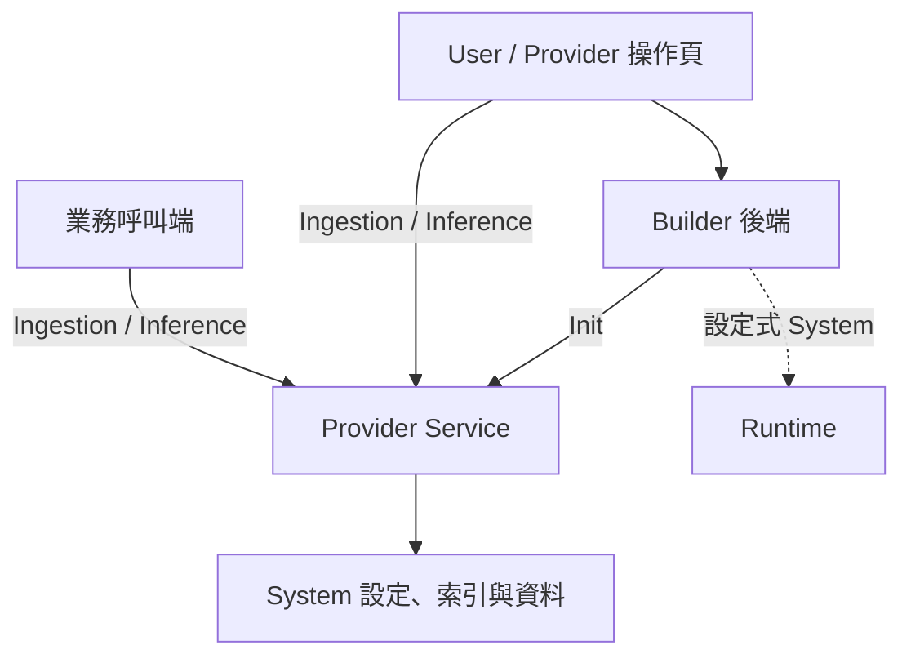
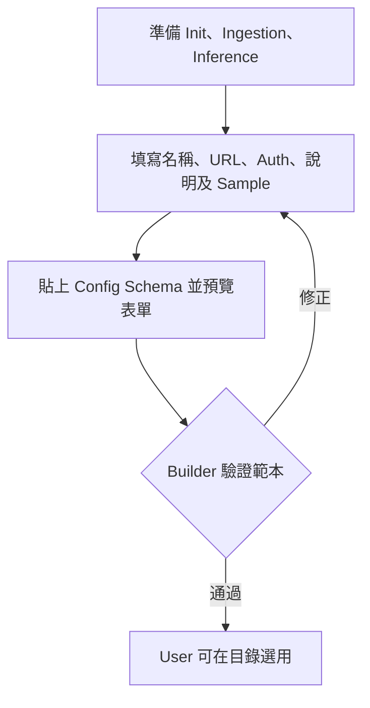
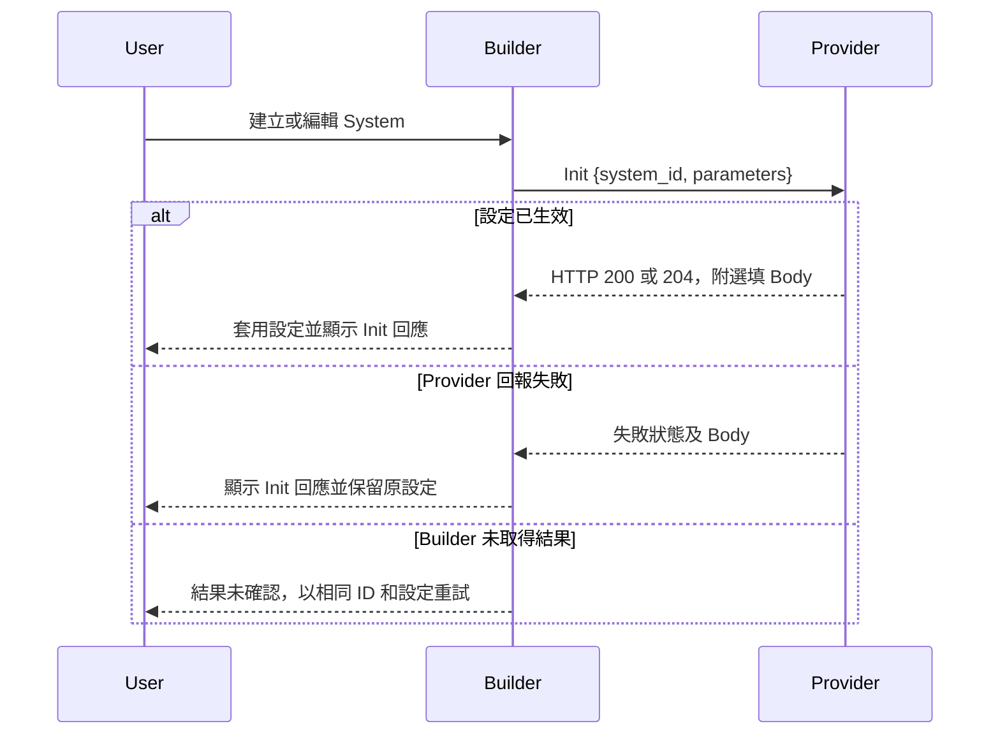
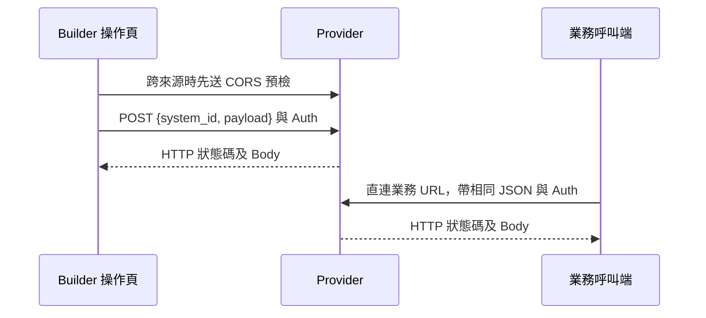

# Provider 模式架構

Python 啟動並提供 React Builder 與管理 API。Builder 管理上架與 System 設定，Provider 以 `system_id` 管理生效設定及資料。Builder 操作頁和應用程式直接呼叫 Provider 的業務 API。設定式 Runtime 是 Builder 的另一條路徑，可獨立整合既有的索引與生命週期操作。

## Provider 上架

範本上架會驗證欄位及 Schema。建立 System 時才會呼叫 Init 驗證實際連線與初始化。

## User 建立與編輯設定

Edit Config 沿用既有 System ID。Provider 應先驗證並準備資源，完成後才切換生效設定。同一個 ID 和設定重送時應能安全重試。若逾時，Provider 可能已收到並處理該次 Init，Builder 會等成功回應才更新本機紀錄。

## User 測試與應用程式呼叫

Provider 依 Auth 判斷呼叫者可否操作該 System，再依 ID 讀取 Init 保存的設定。Ingestion Payload 內各種操作的意義與資料生命週期由 Provider 定義。
