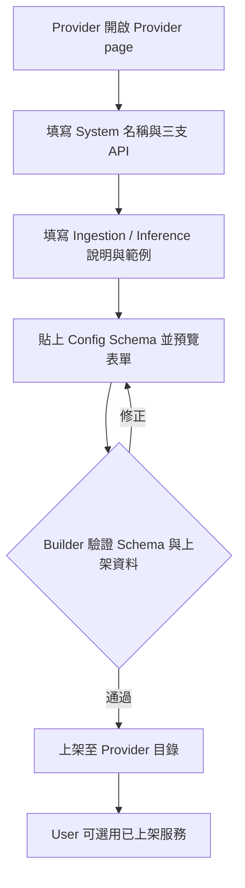
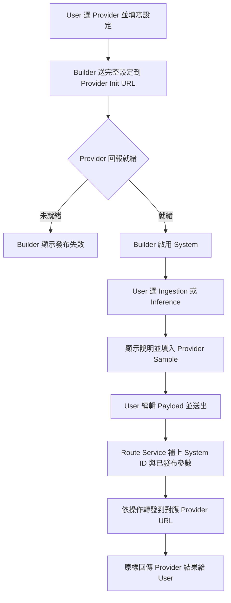

# Provider 與 User 流程

## Provider 上架視角

Provider 預覽與 User 建立表單使用相同欄位渲染。Provider 提供三支固定 API，並透過各業務 API 的說明與範例定義各自的操作。

## User 建立與送出請求

Builder 發起 Init，Provider 執行資源初始化。業務呼叫使用固定的 System Ingestion／Inference 路徑，Route Service 保留呼叫端 Auth，Provider 判斷 Payload 的操作並管理資料。
