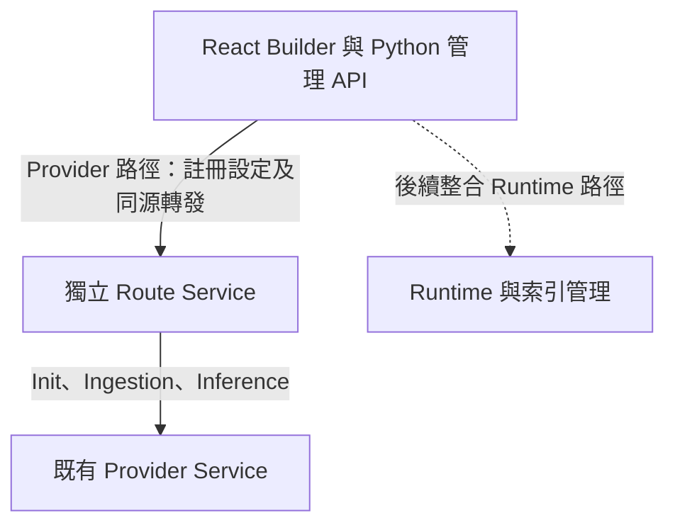
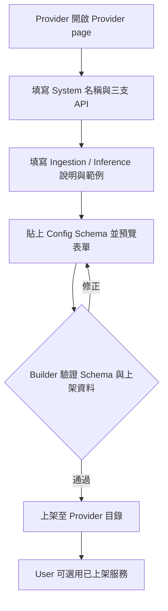
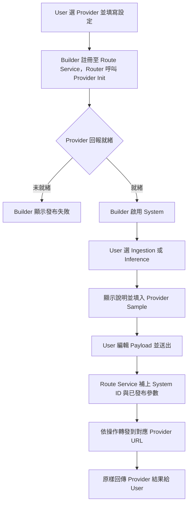

# Builder、Route Service 與 Runtime

Builder 的 Python 程序建置並提供 React 前端和管理 API。Provider 版 System 由獨立 Route Service 呼叫現有的 Retrieval Provider，可透過匯出的 YAML 在沒有 Builder 的環境啟動。

Provider 路徑先滿足快速接入既有服務的需求。Runtime 路徑與它平行，日後再接回原有的索引重建與 Runtime 生命週期操作。這次的執行介面是 Router MVP 的 Provider 路徑。

## Provider 上架視角

Provider 預覽與 User 建立表單使用相同欄位渲染。Provider 提供三支固定 API，並透過各業務 API 的說明與範例定義各自的操作。

## User 建立與送出請求

Builder 發起註冊，Route Service 呼叫 Init，Provider 執行資源初始化。瀏覽器透過 Builder 的同源入口送出業務請求，部署後的呼叫端也可直連 Router。Route Service 保留呼叫端 Auth，Provider 判斷 Payload 的操作並管理資料。
